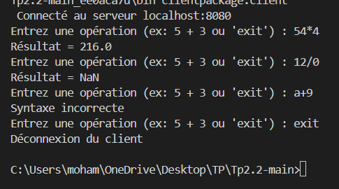
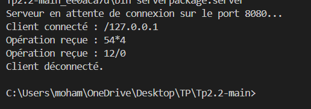

# TP2 : Application Client/Serveur avec Sockets Java

Ce TP met en place une architecture client/serveur TCP en Java. Le client saisit une expression arithmétique, l'encapsule dans un objet sérialisable Operation, puis l'envoie via un flux ObjectOutputStream. Le serveur, en écoute sur le port 8080, réceptionne l'objet à l'aide d'un ObjectInputStream, effectue le calcul (+, -, *, /) et retourne le résultat numérique. Ce projet permet d'illustrer la communication par sockets, la sérialisation d'objets et la gestion des flux réseau en Java.

## Execution

